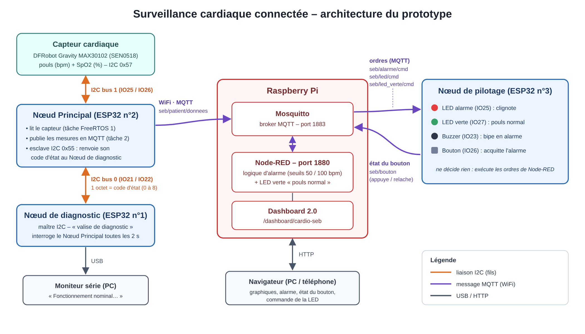

# Mini-projet SEB – Surveillance cardiaque connectée (ESP32 + MQTT + Node-RED)

Prototype de surveillance du **pouls** et de la **SpO2** pour personnes âgées, réalisé dans le cours Systèmes Embarqués Biomédicaux (ISIS).



- **Nœud Principal** (ESP32) : capteur DFRobot Gravity MAX30102 + envoi MQTT + esclave I2C, avec 2 tâches FreeRTOS.
- **Nœud de diagnostic** (ESP32) : maître I2C, affiche l'état du Nœud Principal dans le moniteur série.
- **Nœud de pilotage** (ESP32) : LED d'alarme, LED verte, buzzer et bouton, pilotés via MQTT.
- **Raspberry Pi** : Mosquitto + Node-RED (dashboard, logique d'alarme).

📖 **Toute la documentation est dans le [Wiki](../../wiki).**

## Contenu

```text
code/
  esp32_principal/esp32_principal.ino
  esp32_diagnostic/esp32_diagnostic.ino
  esp32_pilotage/esp32_pilotage.ino
  outils/diagnostic_capteur/diagnostic_capteur.ino
node-red/
  flow_nodered_seb.json
images/
```

## Démarrage rapide

1. **Raspberry Pi** : installer Mosquitto (avec accès distant), Node-RED et `@flowfuse/node-red-dashboard`. Importer `node-red/flow_nodered_seb.json`, puis **Déployer**.
2. **ESP32** : installer les bibliothèques **PubSubClient**, **DFRobot_BloodOxygen_S** et **DFRobot_RTU**. Renseigner le WiFi et l'IP de la Raspberry dans `esp32_principal.ino` et `esp32_pilotage.ino`, puis téléverser chaque code sur son ESP32.
3. **Dashboard** : `http://<IP-Raspberry>:1880/dashboard/cardio-seb`
