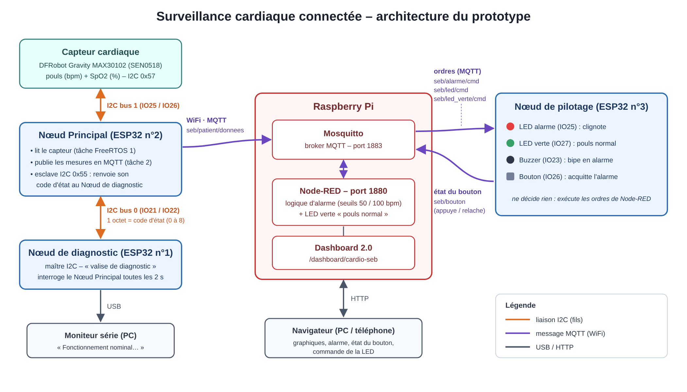

# Mini-projet SEB – Surveillance cardiaque connectée

**Cours** : Systèmes Embarqués Biomédicaux – ISIS (INSA), 4e année
**Thème** : surveillance de personnes âgées

Notre prototype mesure le **pouls** et la **saturation en oxygène** d'une personne âgée. Il affiche les mesures en temps réel sur un **dashboard Node-RED** et déclenche une **alarme** (dashboard, LED, buzzer) quand le pouls sort de la plage normale. Un soignant acquitte l'alarme avec un bouton. Un ESP32 de **diagnostic**, relié en I2C, affiche l'état de fonctionnement du système.



## Pages du wiki

| Page | Contenu |
|---|---|
| [Projet – Surveillance cardiaque](Projet-Surveillance-cardiaque) | **Page principale du projet** : aperçu, prérequis, composants, schémas, fonctionnement, code, tests |
| [TP1 – Configuration de l'ESP32](TP1-Configuration-ESP32) | Installation de l'ESP32 dans l'Arduino IDE, adresse MAC |
| [TP2 – MQTT et Node-RED](TP2-MQTT-et-Node-RED) | Raspberry Pi, Mosquitto, Node-RED, Dashboard 2.0, adresses IP |
| [TP3 – I2C, FreeRTOS et capteur cardiaque](TP3-I2C-FreeRTOS-et-capteur) | Logbook : liaison I2C, capteur cardiaque, FreeRTOS, MQTT, problèmes rencontrés |

## Contenu du dépôt

```text
code/
  esp32_principal/esp32_principal.ino      Nœud Principal (capteur + esclave I2C + MQTT, FreeRTOS)
  esp32_diagnostic/esp32_diagnostic.ino    Nœud de diagnostic (maître I2C, moniteur série)
  esp32_pilotage/esp32_pilotage.ino        Nœud de pilotage (LED, LED verte, buzzer, bouton)
  outils/diagnostic_capteur/               outil : trouve sur quelles broches répond le capteur
node-red/
  flow_nodered_seb.json                    flow Node-RED (à importer)
images/                                    schémas, captures, photos
```

## Équipe

| Membre | Partie |
|---|---|
| Wiam Agnagay | Raspberry Pi : Mosquitto, Node-RED, dashboard |
| *(à compléter)* | ESP32 (Arduino IDE) |
| *(à compléter)* | ESP32 (Arduino IDE) |
