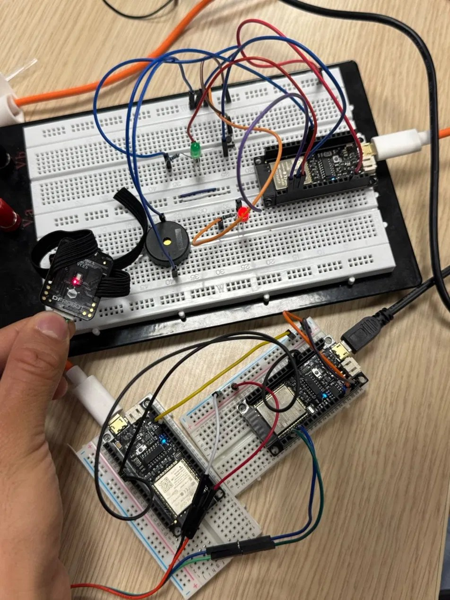
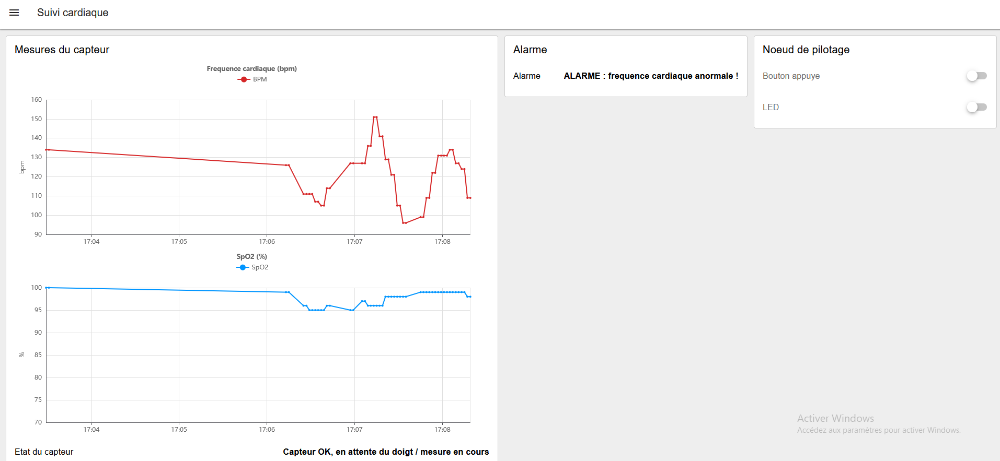
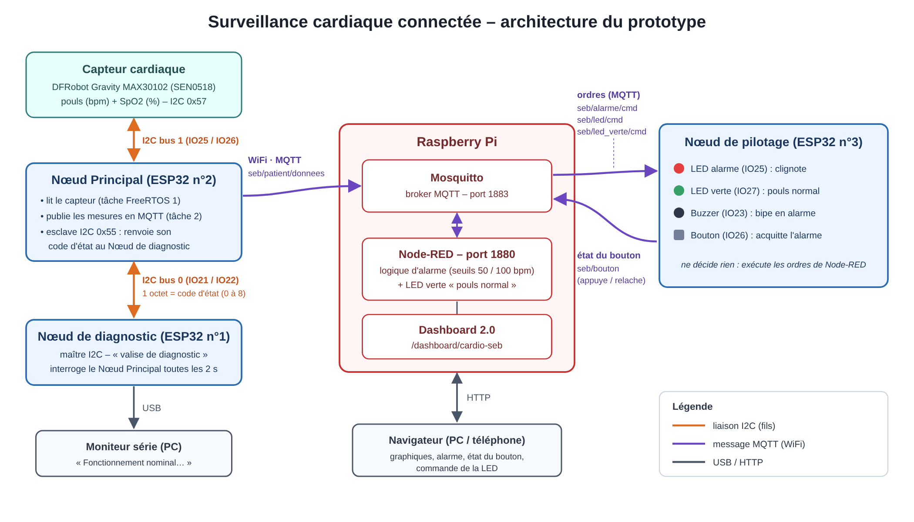
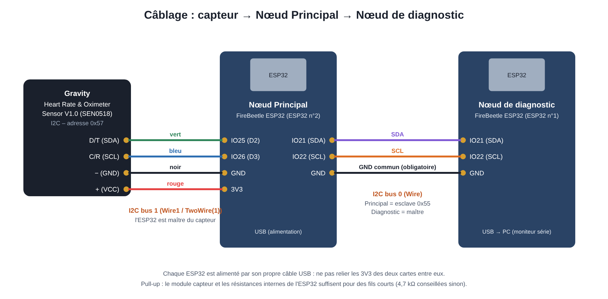
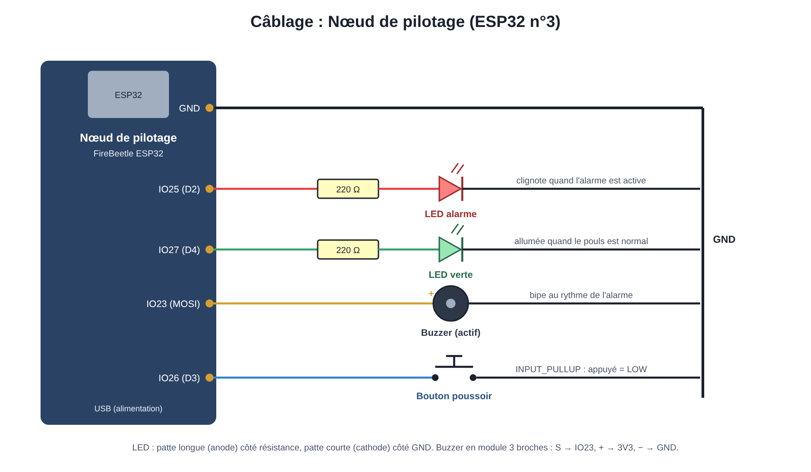
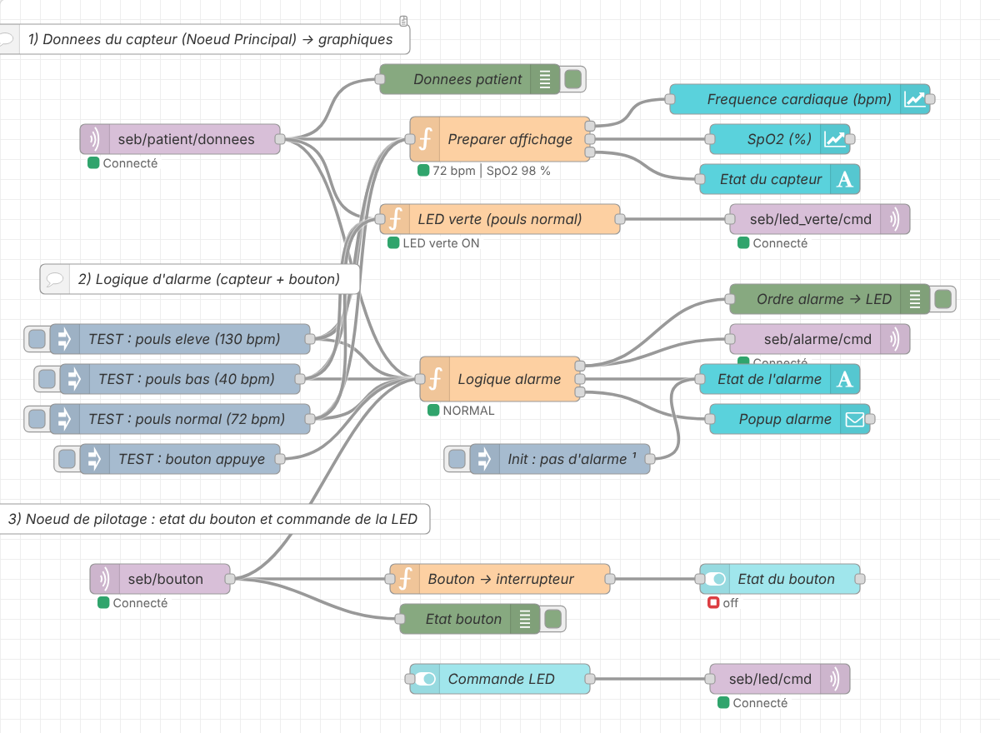

# Surveillance cardiaque connectée pour personnes âgées (ESP32 + MQTT + Node-RED)

Ce projet surveille **le pouls et la saturation en oxygène (SpO2)** d'une personne âgée grâce à un capteur posé au bout du doigt. Les mesures partent en WiFi (MQTT) vers une **Raspberry Pi**, qui les affiche en temps réel sur un **tableau de bord Node-RED**.

Si le pouls sort de la plage normale (50 à 100 bpm), une **alarme** se déclenche :
- un message et une notification apparaissent sur le dashboard ;
- une LED clignote et un buzzer sonne sur le boîtier de pilotage.

Un soignant peut **acquitter l'alarme avec un bouton**. Une **LED verte** reste allumée tant que le pouls est normal.

Un troisième ESP32, relié en **I2C**, joue le rôle de **« valise de diagnostic »** : il affiche dans le moniteur série l'état de fonctionnement du système (capteur, WiFi, broker MQTT…).



*Le prototype : en haut, le Nœud de pilotage (LED d'alarme rouge, LED verte, buzzer, bouton) ; en bas, le Nœud Principal et le Nœud de diagnostic reliés en I2C ; à gauche, le capteur cardiaque DFRobot posé au bout du doigt.*


*Le dashboard pendant un test : courbes du pouls et de la SpO2, alarme déclenchée (pouls > 100 bpm).*

---

## Sommaire

1. [Aperçu du projet](#1-aperçu-du-projet-project-overview)
2. [Prérequis](#2-prérequis)
3. [Composants nécessaires](#3-composants-nécessaires-parts-required)
4. [Schémas électriques](#4-schémas-électriques)
5. [Fonctionnement détaillé](#5-fonctionnement-détaillé)
6. [Explications du code](#6-explications-du-code-parties-essentielles)
7. [Installation pas à pas](#7-installation-pas-à-pas)
8. [Tests et démonstration](#8-tests-et-démonstration)
9. [Problèmes rencontrés et solutions](#9-problèmes-rencontrés-et-solutions)
10. [Limites et améliorations](#10-limites-et-améliorations)
11. [Références](#11-références)

---

## 1. Aperçu du projet (Project Overview)



Le prototype repose sur **3 ESP32** et **1 Raspberry Pi** :

| Élément | Rôle |
|---|---|
| **Nœud Principal** (ESP32 n°2) | Lit le capteur cardiaque, envoie les mesures en MQTT et répond au Nœud de diagnostic en I2C. Il utilise **deux tâches FreeRTOS** en parallèle : une pour le capteur, une pour le WiFi/MQTT. C'est aussi sur cet ESP32 que sera faite la future partie TinyML. |
| **Nœud de diagnostic** (ESP32 n°1) | Maître I2C. Toutes les 2 s, il demande au Nœud Principal son **code d'état** (1 octet) et affiche sa signification dans le moniteur série, comme une valise de diagnostic chez le garagiste. |
| **Nœud de pilotage** (ESP32 n°3) | Ne prend aucune décision : il **exécute les ordres de Node-RED** (LED d'alarme, LED verte, buzzer) et **envoie l'état de son bouton** (appuyé / relâché). |
| **Raspberry Pi** | Héberge le broker **Mosquitto** et **Node-RED**. Node-RED reçoit les mesures, décide de l'alarme, affiche le **dashboard** et commande le Nœud de pilotage. |

### Scénario de fonctionnement

1. Le capteur mesure le pouls et la SpO2. Le Nœud Principal les lit toutes les 2 s sur son **2e bus I2C** (IO25/IO26).
2. Le Nœud Principal publie un message JSON sur `seb/patient/donnees`.
3. Node-RED trace les courbes sur le dashboard et vérifie les seuils :
   - **pouls normal** (50–100 bpm) : la LED verte s'allume ;
   - **pouls anormal** : l'alarme se déclenche (texte et notification sur le dashboard, LED qui clignote, buzzer).
4. Le soignant appuie sur le **bouton**. Node-RED passe l'alarme à l'état **acquittée** et coupe la LED et le buzzer. L'alarme ne se relancera que si le pouls redevient normal puis de nouveau anormal.
5. Pendant tout ce temps, le Nœud de diagnostic interroge le Nœud Principal en I2C et affiche son état : *« Fonctionnement nominal : acquisition capteur en cours »*, *« Impossible de se connecter au WiFi »*, *« Problème liaison capteur »*…

### Messages MQTT échangés

| Topic | De → vers | Contenu |
|---|---|---|
| `seb/patient/donnees` | Nœud Principal → Node-RED | JSON, toutes les 2 s : `{"code":0,"message":"Fonctionnement nominal : ...","bpm":72,"spo2":98}` |
| `seb/alarme/cmd` | Node-RED → Nœud de pilotage | `ON` / `OFF` : alarme (LED clignotante + buzzer) |
| `seb/led_verte/cmd` | Node-RED → Nœud de pilotage | `ON` / `OFF` : pouls normal |
| `seb/led/cmd` | Dashboard → Nœud de pilotage | `on` / `off` : commande manuelle de la LED |
| `seb/bouton` | Nœud de pilotage → Node-RED | `appuye` / `relache`, envoyé à chaque changement |

### Correspondance avec le cahier des charges (partie Infrastructure)

| Exigence | Réalisation |
|---|---|
| Nœud Principal : acquisition d'un capteur de santé | Capteur DFRobot Gravity MAX30102 (pouls + SpO2) |
| Nœud de pilotage : LED et/ou buzzer pilotés via MQTT | LED d'alarme, LED verte et buzzer, commandés par `seb/alarme/cmd`, `seb/led/cmd` et `seb/led_verte/cmd` |
| Nœud de pilotage : bouton qui transmet son état via MQTT | `seb/bouton` : `appuye` / `relache` |
| Nœud de diagnostic relié en I2C, état affiché dans le moniteur série | 9 codes d'état (0 à 8) avec un message explicite |
| Node-RED : graphique des données du capteur | 2 courbes : pouls (bpm) et SpO2 (%) |
| Node-RED : état du bouton de l'ESP32 | Interrupteur « Bouton appuyé » |
| Node-RED : commande d'une LED depuis le dashboard | Interrupteur « LED » |
| Node-RED : alarme si une donnée dépasse un seuil, visible sur le dashboard et sur la LED, en tenant compte d'un bouton | Seuils 50 / 100 bpm ; texte, notification, LED et buzzer ; acquittement par le bouton |
| Parallélisation de tâches avec FreeRTOS | 2 tâches (capteur / MQTT) reliées par une file (queue) sur le Nœud Principal |

---

## 2. Prérequis

**Côté PC : Arduino IDE et ESP32**
- [Installer les cartes ESP32 dans Arduino IDE 2](https://randomnerdtutorials.com/installing-esp32-arduino-ide-2-0/). URL du gestionnaire de cartes : `https://raw.githubusercontent.com/espressif/arduino-esp32/gh-pages/package_esp32_index.json`. Voir aussi notre page [TP1 – Configuration de l'ESP32](TP1-Configuration-ESP32).
- [ESP32 MQTT – Publish and Subscribe with Arduino IDE](https://randomnerdtutorials.com/esp32-mqtt-publish-subscribe-arduino-ide/)
- [ESP32 with FreeRTOS (Arduino IDE) – Create Tasks](https://randomnerdtutorials.com/esp32-freertos-arduino-tasks/)
- Bibliothèques Arduino à installer (Gestionnaire de bibliothèques) :
  - **PubSubClient** (Nick O'Leary) : client MQTT, pour le Nœud Principal et le Nœud de pilotage.
  - **DFRobot_BloodOxygen_S** et **DFRobot_RTU** (DFRobot) : capteur cardiaque, pour le Nœud Principal. La première a besoin de la seconde.

**Côté Raspberry Pi**
- [Install Mosquitto MQTT Broker on Raspberry Pi](https://randomnerdtutorials.com/how-to-install-mosquitto-broker-on-raspberry-pi/). Ne pas oublier la section **« Enable remote access »**, sinon les ESP32 ne peuvent pas se connecter.
- [Running Node-RED on Raspberry Pi](https://nodered.org/docs/getting-started/raspberrypi), ou [Getting Started with Node-RED on Raspberry Pi](https://randomnerdtutorials.com/getting-started-node-red-raspberry-pi/).
- [FlowFuse Dashboard (Dashboard 2.0)](https://dashboard.flowfuse.com/getting-started.html) : dans Node-RED, menu → *Gérer la palette* → *Installer* → **`@flowfuse/node-red-dashboard`**. Attention, ce n'est pas l'ancien `node-red-dashboard`.

Toutes les commandes d'installation sont détaillées dans la page [TP2 – MQTT et Node-RED](TP2-MQTT-et-Node-RED).

---

## 3. Composants nécessaires (Parts required)

| Composant | Référence | Qté | Utilisé par |
|---|---|---|---|
| Carte ESP32 | DFRobot **FireBeetle ESP32** (DFR0478) | 3 | les 3 nœuds |
| Raspberry Pi | modèle utilisé en TP, avec carte microSD et alimentation | 1 | broker MQTT + Node-RED |
| Capteur cardiaque / oxymètre | DFRobot **Gravity: MAX30102 Heart Rate & Oximeter Sensor V1.0** (SEN0518), I2C (adresse 0x57), alimentation 3,3 V ou 5 V | 1 | Nœud Principal |
| LED 5 mm (alarme) | LED rouge conseillée | 1 | Nœud de pilotage |
| LED 5 mm verte | pouls normal | 1 | Nœud de pilotage |
| Résistance | 220 Ω | 2 | une par LED |
| Buzzer | buzzer **actif** 3,3 V (ou passif, voir le code) | 1 | Nœud de pilotage |
| Bouton poussoir | 2 ou 4 pattes | 1 | Nœud de pilotage |
| Breadboard | 400 points | 3 | |
| Câbles Dupont | M-M et M-F | ~20 | |
| Câble USB | micro-USB | 3 | alimentation et programmation |

---

## 4. Schémas électriques

### Capteur → Nœud Principal → Nœud de diagnostic



| De | Vers | Remarque |
|---|---|---|
| Capteur D/T (fil **vert**) | Nœud Principal **IO25** (D2) | SDA du bus I2C n°1 |
| Capteur C/R (fil **bleu**) | Nœud Principal **IO26** (D3) | SCL du bus I2C n°1 |
| Capteur + (fil **rouge**) | Nœud Principal **3V3** | pas de 5 V, pour protéger les broches de l'ESP32 |
| Capteur − (fil **noir**) | Nœud Principal **GND** | |
| Nœud Principal **IO21** (SDA) | Nœud de diagnostic **IO21** | bus I2C n°0 |
| Nœud Principal **IO22** (SCL) | Nœud de diagnostic **IO22** | bus I2C n°0 |
| Nœud Principal **GND** | Nœud de diagnostic **GND** | masse commune **obligatoire** |

> ⚠️ Le capteur doit être branché directement sur IO25/IO26, et **pas** dans les mêmes rangées de breadboard que le bus IO21/IO22. Sinon il se retrouve sur le bus du Nœud de diagnostic (voir [Problèmes rencontrés](#9-problèmes-rencontrés-et-solutions)).

### Nœud de pilotage



| Broche ESP32 | Composant |
|---|---|
| **IO25** (D2) | résistance 220 Ω → LED d'alarme → GND |
| **IO27** (D4) | résistance 220 Ω → LED verte → GND |
| **IO23** (MOSI) | buzzer (+) ; buzzer (−) → GND |
| **IO26** (D3) | bouton poussoir → GND (résistance de pull-up interne de l'ESP32) |

---

## 5. Fonctionnement détaillé

### 5.1 Nœud Principal : capteur, FreeRTOS, MQTT et esclave I2C

**Deux bus I2C sur le même ESP32.** Le capteur communique en I2C. Or le bus I2C n°0 (`Wire`, IO21/IO22) est déjà utilisé en **esclave** pour répondre au Nœud de diagnostic. On utilise donc le **2e contrôleur I2C** de l'ESP32 (`TwoWire(1)`), en **maître**, sur IO25/IO26.

**Lecture du capteur.** La bibliothèque DFRobot renvoie le pouls et la SpO2. Le capteur met à jour ses valeurs toutes les 4 s environ, et renvoie `-1` quand il n'y a pas de doigt ou que la mesure est en cours. Le Nœud Principal en déduit un **code d'état** :

| Code | Message (affiché par le Nœud de diagnostic) | Type | Quand ? |
|---|---|---|---|
| 0 | Fonctionnement nominal : acquisition capteur en cours | technique | mesure valide, pouls normal |
| 1 | Impossible de se connecter au WiFi | technique | WiFi perdu (routeur coupé) |
| 2 | Probleme liaison capteur (capteur debranche ?) | technique | le capteur ne répond plus en I2C |
| 3 | Erreur de lecture du capteur (valeurs incoherentes) | technique | pouls > 250 ou SpO2 > 100 |
| 4 | Capteur OK, en attente du doigt / mesure en cours | capteur | valeurs à -1 |
| 5 | Alerte : frequence cardiaque trop basse | capteur | pouls < 50 bpm |
| 6 | Alerte : frequence cardiaque trop haute | capteur | pouls > 100 bpm |
| 7 | Alerte : saturation en oxygene trop basse | capteur | SpO2 < 90 % |
| 8 | WiFi OK mais broker MQTT (Raspberry) injoignable | technique | Mosquitto arrêté ou mauvaise IP |

Un seul code peut être envoyé à la fois. L'ordre de priorité est le suivant : **capteur débranché > WiFi perdu > broker injoignable > état de la mesure**.

**Deux tâches FreeRTOS en parallèle :**
- `tacheCapteur` (cœur 1) : lit le capteur toutes les 2 s, calcule le code d'état et dépose la mesure dans une **file FreeRTOS**.
- `tacheMQTT` (cœur 0) : maintient le WiFi et la connexion au broker, récupère la mesure dans la file et la publie en JSON.

Grâce à ce découpage, si le WiFi tombe, **la lecture du capteur et la liaison I2C continuent** : le Nœud de diagnostic peut alors afficher « Impossible de se connecter au WiFi ».

### 5.2 Nœud de diagnostic : la « valise de diagnostic »

Toutes les 2 s, il fait `Wire.requestFrom(0x55, 1)` : il demande **1 octet** au Nœud Principal, puis affiche le code et sa description :

```text
-----------------------------
Code erreur : 0
Description : Fonctionnement nominal : acquisition capteur en cours
-----------------------------
-----------------------------
Code erreur : 2
Description : Probleme liaison capteur (capteur debranche ?)
-----------------------------
Erreur : aucune reponse du Noeud Principal (liaison I2C ou alimentation)
```

Le dernier message apparaît quand le Nœud Principal ne répond plus du tout : fil SDA, SCL ou GND débranché, ou carte éteinte.

### 5.3 Nœud de pilotage

| Il reçoit… | Il fait… |
|---|---|
| `seb/alarme/cmd` = `ON` | la LED d'alarme clignote (250 ms) et le buzzer bipe au même rythme |
| `seb/alarme/cmd` = `OFF` | arrêt du clignotement et du buzzer |
| `seb/led_verte/cmd` = `ON` / `OFF` | allume / éteint la LED verte |
| `seb/led/cmd` = `on` / `off` | hors alarme, la LED suit l'interrupteur du dashboard |

Il **publie** `appuye` ou `relache` sur `seb/bouton` à chaque changement d'état du bouton, avec un anti-rebond de 50 ms. Les ordres de Node-RED sont envoyés avec l'option **retain** : si l'ESP32 redémarre, il récupère tout de suite le dernier état.

### 5.4 Node-RED (Raspberry Pi)



Le flow ([`depot/node-red/flow_nodered_seb.json`](https://github.com/Wiamagnagay/iotprojet/blob/main/depot/node-red/flow_nodered_seb.json)) comporte 3 parties :

1. **Données du capteur → graphiques.** Le nœud `mqtt in` reçoit `seb/patient/donnees` (JSON). La fonction *Préparer affichage* envoie le pouls vers un graphique, la SpO2 vers un autre et le message d'état vers un texte. La fonction *LED verte (pouls normal)* envoie `ON`/`OFF` sur `seb/led_verte/cmd`.
2. **Logique d'alarme.** La fonction *Logique alarme* reçoit à la fois les données du capteur **et l'état du bouton**. Elle gère 3 états :

   | État actuel | Événement | Nouvel état | Actions |
   |---|---|---|---|
   | NORMAL | pouls < 50 ou > 100 bpm | **ALARME** | `ON` sur `seb/alarme/cmd`, texte « ALARME », notification |
   | ALARME | bouton **appuyé** | **ACQUITTÉE** | `OFF` sur `seb/alarme/cmd`, texte « Alarme acquittée par le bouton » |
   | ALARME ou ACQUITTÉE | pouls revenu entre 50 et 100 | **NORMAL** | `OFF`, texte « Pas d'alarme » |

   Une mesure invalide (pas de doigt, `bpm = 0`) ne change pas l'état.
   Les nœuds **TEST : …** permettent de simuler un pouls élevé, un pouls bas, un pouls normal ou un appui sur le bouton, sans les ESP32.
3. **Nœud de pilotage.** L'état du bouton (`seb/bouton`) est affiché par un interrupteur du dashboard. L'interrupteur « LED » du dashboard publie `on`/`off` sur `seb/led/cmd`.

**Le dashboard** est accessible à l'adresse `http://<IP de la Raspberry>:1880/dashboard/cardio-seb`. Il comporte 3 groupes :
- **Mesures du capteur** : courbe du pouls, courbe de la SpO2 et état du capteur ;
- **Alarme** : état de l'alarme, avec une notification rouge quand elle se déclenche ;
- **Nœud de pilotage** : état du bouton et commande de la LED.

---

## 6. Explications du code (parties essentielles)

Le code complet se trouve dans le dossier [`depot/code/`](https://github.com/Wiamagnagay/iotprojet/tree/main/depot/code) du dépôt, et le flow Node-RED dans [`depot/node-red/`](https://github.com/Wiamagnagay/iotprojet/tree/main/depot/node-red). Voici seulement les parties clés.

| Fichier | ESP32 |
|---|---|
| [`esp32_principal.ino`](https://github.com/Wiamagnagay/iotprojet/blob/main/depot/code/esp32_principal/esp32_principal.ino) | Nœud Principal (ESP32 n°2) |
| [`esp32_diagnostic.ino`](https://github.com/Wiamagnagay/iotprojet/blob/main/depot/code/esp32_diagnostic/esp32_diagnostic.ino) | Nœud de diagnostic (ESP32 n°1) |
| [`esp32_pilotage.ino`](https://github.com/Wiamagnagay/iotprojet/blob/main/depot/code/esp32_pilotage/esp32_pilotage.ino) | Nœud de pilotage (ESP32 n°3) |
| [`diagnostic_capteur.ino`](https://github.com/Wiamagnagay/iotprojet/blob/main/depot/code/outils/diagnostic_capteur/diagnostic_capteur.ino) | outil : trouve sur quelles broches répond le capteur |
| [`flow_nodered_seb.json`](https://github.com/Wiamagnagay/iotprojet/blob/main/depot/node-red/flow_nodered_seb.json) | flow Node-RED à importer |

### Nœud Principal : esclave I2C + 2e bus pour le capteur

```cpp
TwoWire I2C_2 = TwoWire(1);                       // 2e contrôleur I2C de l'ESP32
DFRobot_BloodOxygen_S_I2C MAX30102(&I2C_2, 0x57); // le capteur est sur ce bus

void onRequest() {            // appelée quand le Nœud de diagnostic demande l'état
  Wire.write(errorCode);      // 1 octet = code d'état (0 à 8)
}

void setup() {
  Wire.onRequest(onRequest);
  Wire.begin((uint8_t)0x55);        // bus 0 (IO21/22) : ESCLAVE, adresse 0x55
  I2C_2.begin(25, 26, 100000);      // bus 1 (IO25/26) : MAÎTRE du capteur
}
```

### Nœud Principal : deux tâches FreeRTOS reliées par une file

```cpp
fileMesures = xQueueCreate(1, sizeof(Mesure));   // file d'une case : la dernière mesure
xTaskCreatePinnedToCore(tacheCapteur, "tacheCapteur", 4096, NULL, 2, NULL, 1); // cœur 1
xTaskCreatePinnedToCore(tacheMQTT,    "tacheMQTT",    8192, NULL, 1, NULL, 0); // cœur 0

// dans tacheCapteur : on dépose la mesure (en écrasant l'ancienne)
xQueueOverwrite(fileMesures, &m);

// dans tacheMQTT : on attend une mesure (100 ms max) puis on la publie en JSON
if (xQueueReceive(fileMesures, &m, pdMS_TO_TICKS(100)) == pdTRUE && mqttOK) {
  snprintf(json, sizeof(json), "{\"code\":%d,\"message\":\"%s\",\"bpm\":%d,\"spo2\":%d}",
           m.code, getErrorMessage(m.code), m.bpm, m.spo2);
  client.publish("seb/patient/donnees", json);
}
```

### Nœud de pilotage : exécuter les ordres reçus (version simplifiée)

```cpp
void callback(char *topic, byte *message, unsigned int length) {
  String msg;  for (unsigned int i = 0; i < length; i++) msg += (char)message[i];
  String t = String(topic);

  if (t == "seb/led/cmd")            { ledDemandee  = (msg == "on"); }
  else if (t == "seb/led_verte/cmd") { ledVerte     = (msg == "ON"); }
  else if (t == "seb/alarme/cmd")    { alarmeActive = (msg == "ON"); }  // LED clignotante + buzzer
}
```

### Node-RED : la logique d'alarme (extrait de la fonction *Logique alarme*)

```js
if (msg.topic === "seb/bouton") {
    if (msg.payload === "appuye" && precedent === "ALARME") etat = "ACQUITTEE";
} else {
    const bpm = msg.payload.bpm;
    if (!(bpm > 0)) return null;                    // pas de mesure valide
    const anormal = (bpm > BPM_MAX || bpm < BPM_MIN);
    if (!anormal)                    etat = "NORMAL";
    else if (precedent === "NORMAL") etat = "ALARME";
}
```

---

## 7. Installation pas à pas

1. **Raspberry Pi** : installer Mosquitto (avec accès distant), Node-RED et Dashboard 2.0 (voir [Prérequis](#2-prérequis)).
2. **Node-RED** :
   - menu ☰ → **Importer** → choisir `depot/node-red/flow_nodered_seb.json` → **Importer** → **Déployer** ;
   - vérifier que les nœuds MQTT affichent **« Connecté »**.
3. **ESP32** : dans `esp32_principal.ino` et `esp32_pilotage.ino`, renseigner le WiFi et l'IP de la Raspberry :
   ```cpp
   const char *ssid        = "NomDuWifi";
   const char *password    = "MotDePasse";
   const char *mqtt_server = "172.18.32.44";   // IP de notre Raspberry (commande : hostname -I)
   ```
4. **Téléverser** chaque fichier sur son ESP32 :
   - `esp32_principal.ino` sur l'ESP32 n°2 ;
   - `esp32_diagnostic.ino` sur l'ESP32 n°1 ;
   - `esp32_pilotage.ino` sur l'ESP32 n°3.
5. Ouvrir le dashboard : `http://172.18.32.44:1880/dashboard/cardio-seb`.

> 💡 Pour suivre tous les messages MQTT en direct depuis la Raspberry : `mosquitto_sub -h localhost -t "seb/#" -v`

---

## 8. Tests et démonstration

| Scénario | Action | Résultat attendu |
|---|---|---|
| Fonctionnement nominal | doigt posé sur le capteur, immobile, 10-15 s | diagnostic : code 0 ; courbes mises à jour ; LED verte allumée |
| Pas de doigt | retirer le doigt | diagnostic : code 4 ; LED verte éteinte |
| Capteur débranché | débrancher le capteur | diagnostic : code 2 « Probleme liaison capteur » |
| WiFi coupé | couper le routeur / partage de connexion | diagnostic : code 1 « Impossible de se connecter au WiFi » |
| Broker arrêté | `sudo systemctl stop mosquitto` sur la Raspberry | diagnostic : code 8 |
| Liaison I2C coupée | débrancher SDA entre les deux ESP32 | diagnostic : « aucune reponse du Noeud Principal » |
| Pouls trop haut | effort physique, ou nœud *TEST : pouls eleve* | texte « ALARME » + notification, LED qui clignote, buzzer, LED verte éteinte |
| Acquittement | appui sur le bouton pendant l'alarme | « Alarme acquittée par le bouton », LED et buzzer coupés |
| Retour à la normale | pouls entre 50 et 100 | « Pas d'alarme », LED verte allumée |
| Commande LED | interrupteur « LED » du dashboard | la LED du Nœud de pilotage s'allume / s'éteint |
| État du bouton | appuyer / relâcher le bouton | l'interrupteur « Bouton appuyé » du dashboard suit |

---

## 9. Problèmes rencontrés et solutions

| Problème | Cause | Solution |
|---|---|---|
| « Capteur cardiaque introuvable » dans le moniteur série | les fils D/T et C/R du capteur étaient branchés dans les rangées de breadboard du **bus IO21/IO22** (celui du Nœud de diagnostic) au lieu de IO25/IO26 | sketch d'aide [`depot/code/outils/diagnostic_capteur`](https://github.com/Wiamagnagay/iotprojet/tree/main/depot/code/outils/diagnostic_capteur) qui teste toutes les broches, puis branchement direct du capteur sur D2/D3 |
| Le capteur I2C ne peut pas partager le bus 0 | le Nœud Principal est **esclave** sur le bus 0 ; il ne peut pas être maître du capteur sur le même bus | utilisation du 2e contrôleur I2C de l'ESP32 (`TwoWire(1)`) |
| Erreur de compilation `DFRobot_RTU.h: No such file` | la bibliothèque du capteur dépend d'une 2e bibliothèque | installer aussi **DFRobot_RTU** |
| Valeurs à `-1` | pas de doigt, ou mesure en cours (mise à jour toutes les ~4 s) | poser le doigt sans appuyer et sans bouger ; code d'état 4 dédié |
| Dashboard : « multiple pages configured with the same URL » | flow importé plusieurs fois : les pages du dashboard sont des nœuds de configuration, qui ne sont pas supprimés avec l'onglet | path de la page changé en `/cardio-seb` et suppression des doublons ; à la réimportation, choisir « Remplacer » |

**Points de vigilance**
- Chaque ESP32 doit avoir un **identifiant MQTT différent** (`ESP32_Principal_SEB`, `ESP32_Pilotage_SEB`). Sinon le broker les déconnecte à tour de rôle.
- Le WiFi doit être en **2,4 GHz**, sans page de connexion.
- Depuis la version 2 de Mosquitto, il faut autoriser l'accès distant : `listener 1883` et `allow_anonymous true`.

---

## 10. Limites et améliorations

- **Mesure sensible aux mouvements** : le capteur doit rester immobile, et les valeurs ne sont mises à jour que toutes les ~4 s.
- **Seuils fixes** (50 / 100 bpm, SpO2 90 %) : ce sont des valeurs de démonstration, à adapter à chaque patient.
- **Pas d'historique** : les courbes ne gardent que les 10 dernières minutes. On pourrait enregistrer les mesures dans une base de données (InfluxDB, SQLite…).
- **Sécurité** : le broker MQTT accepte les connexions anonymes. Il faudrait ajouter un identifiant / mot de passe, voire du TLS.
- **Suite du projet** : partie **TinyML** sur le Nœud Principal (par exemple pour détecter des anomalies du rythme cardiaque).

---

## 11. Références

- Dépôt du cours : [AlCoISIS/TpMqttNodeRed](https://github.com/AlCoISIS/TpMqttNodeRed) et sa page wiki [I2C Master Slave communication with two ESP32s : connexions](https://github.com/AlCoISIS/TpMqttNodeRed/wiki/I2C-Master-Slave-communication-with-two-ESP32s-:-connexions)
- Random Nerd Tutorials :
  - [ESP32 MQTT Publish/Subscribe](https://randomnerdtutorials.com/esp32-mqtt-publish-subscribe-arduino-ide/)
  - [ESP32 with FreeRTOS](https://randomnerdtutorials.com/esp32-freertos-arduino-tasks/)
  - [ESP32 Dual Core](https://randomnerdtutorials.com/esp32-dual-core-arduino-ide/)
  - [Mosquitto sur Raspberry Pi](https://randomnerdtutorials.com/how-to-install-mosquitto-broker-on-raspberry-pi/)
  - [Node-RED sur Raspberry Pi](https://randomnerdtutorials.com/getting-started-node-red-raspberry-pi/)
- [Node-RED – Running on Raspberry Pi](https://nodered.org/docs/getting-started/raspberrypi)
- [FlowFuse Dashboard (Dashboard 2.0)](https://dashboard.flowfuse.com/getting-started.html)
- Capteur : [DFRobot SEN0518 – Gravity MAX30102 Heart Rate and Oximeter Sensor](https://wiki.dfrobot.com/SKU_SEN0518_Gravity_MAX30102_Heart_Rate_and_Oximeter_Sensor), bibliothèques [DFRobot_BloodOxygen_S](https://github.com/DFRobot/DFRobot_BloodOxygen_S) et [DFRobot_RTU](https://github.com/DFRobot/DFRobot_RTU)
- Carte : [DFRobot FireBeetle ESP32 (DFR0478)](https://wiki.dfrobot.com/DFR0478)
- Client MQTT : [PubSubClient](https://github.com/knolleary/pubsubclient)
- Outils de schémas électriques : [Wokwi](https://wokwi.com/), [Cirkit Designer](https://app.cirkitdesigner.com/)
