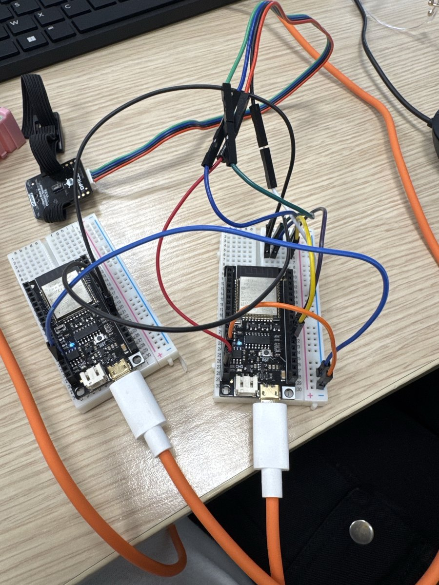
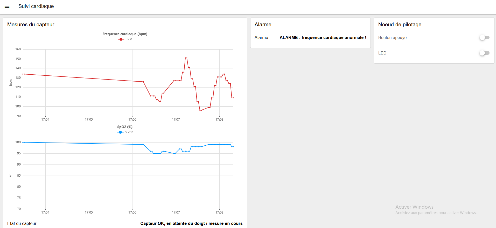

# TP3 – I2C entre deux ESP32, FreeRTOS et capteur cardiaque (logbook)

Ce TP est la « figure imposée » de la partie Infrastructure. Il comporte trois volets :
- faire communiquer deux ESP32 en **I2C** ;
- tester les **capteurs biomédicaux** du projet ;
- faire remonter leurs données jusqu'à **Node-RED** en MQTT.

Le résultat final est décrit dans la page [Projet – Surveillance cardiaque](Projet-Surveillance-cardiaque). Cette page raconte les étapes, séance par séance.

---

## Séance du 20/11/2026 : liaison I2C et ajout du capteur

### 1. Montage I2C Master / Slave
Nous avons suivi la page du cours [I2C Master Slave communication with two ESP32s : connexions](https://github.com/AlCoISIS/TpMqttNodeRed/wiki/I2C-Master-Slave-communication-with-two-ESP32s-:-connexions).

| ESP32 Master | | ESP32 Slave |
|---|---|---|
| IO21 (SDA) | ↔ | IO21 (SDA) |
| IO22 (SCL) | ↔ | IO22 (SCL) |
| GND | ↔ | GND (masse commune obligatoire) |

Chaque ESP32 est alimenté par son propre câble USB : on ne relie pas les 3V3 entre eux.

### 2. Code du cours (`esp32ComBusI2C`)
- **Slave** (adresse `0x55`) : simule un code erreur qui change toutes les 5 s, et le renvoie dans `onRequest()`.
- **Master** : toutes les 2 s, `Wire.requestFrom(0x55, 1)` demande 1 octet, puis le code et sa description sont affichés.

Résultat dans le moniteur série du Master :
```text
-----------------------------
Code erreur : 3
Description : Erreur de lecture du capteur
-----------------------------
```
Le même code apparaît 2 à 3 fois de suite : c'est normal, car le Master interroge toutes les 2 s et le Slave change de code toutes les 5 s.

### 3. Ajout du capteur cardiaque sur le Slave
Notre capteur est le **DFRobot Gravity: MAX30102 Heart Rate & Oximeter Sensor V1.0** (SEN0518). Il communique en **I2C** (adresse `0x57`).

Le Slave utilise déjà son bus I2C n°0 (IO21/IO22) en **esclave**. Le capteur est donc branché sur le **2e contrôleur I2C** de l'ESP32, en maître, sur **IO25 (D2) / IO26 (D3)** :
```cpp
TwoWire I2C_2 = TwoWire(1);
DFRobot_BloodOxygen_S_I2C MAX30102(&I2C_2, 0x57);
I2C_2.begin(25, 26, 100000);
```
Bibliothèques nécessaires : **DFRobot_BloodOxygen_S** et **DFRobot_RTU**.



### 4. Problème : « Capteur cardiaque introuvable »
- **Symptôme** : le moniteur série du Slave affichait en boucle `Capteur cardiaque introuvable`, alors que la liaison avec le Master fonctionnait.
- **Cause** : les fils D/T (vert) et C/R (bleu) du capteur arrivaient dans les rangées de breadboard où passait aussi la liaison **IO21/IO22**. Le capteur se retrouvait sur le bus du Master, et non sur IO25/IO26.
- **Diagnostic** : nous avons écrit un petit programme, `code/outils/diagnostic_capteur`, qui cherche l'adresse `0x57` sur toutes les paires de broches de l'ESP32. Il indique où le capteur répond vraiment.
- **Solution** : brancher les fils du capteur directement dans les connecteurs **D2/D3** de l'ESP32 Slave.

---

## Séance du 24/11/2026 : architecture à 3 ESP32, MQTT et Node-RED

### 1. Répartition des rôles

| ESP32 | Rôle |
|---|---|
| **Nœud Principal** | ancien Slave : capteur + esclave I2C + envoi MQTT |
| **Nœud de diagnostic** | ancien Master : affiche l'état du Nœud Principal dans le moniteur série |
| **Nœud de pilotage** | LED, buzzer et bouton, commandés via MQTT |

### 2. Codes d'erreur adaptés
La simulation du cours a été remplacée par de vrais codes, calculés à partir de l'état du système et des mesures :
- **Codes techniques** : nominal, WiFi, liaison capteur, lecture capteur, broker MQTT.
- **Codes capteur** : pas de doigt, pouls trop bas, pouls trop haut, SpO2 basse.

Les messages ont été reformulés comme ceux d'une valise de diagnostic, par exemple : « Fonctionnement nominal : acquisition capteur en cours ». La table complète est dans la page projet.

### 3. Parallélisation avec FreeRTOS
Le Nœud Principal exécute **deux tâches** :
- `tacheCapteur` (cœur 1) lit le capteur ;
- `tacheMQTT` (cœur 0) gère le WiFi et l'envoi MQTT.

Elles communiquent par une **file FreeRTOS** (`xQueueOverwrite` / `xQueueReceive`). Avantage : si le WiFi tombe, la lecture du capteur et la liaison I2C continuent.

### 4. MQTT et Node-RED
- Le Nœud Principal publie `{"code":..,"message":"..","bpm":..,"spo2":..}` sur `seb/patient/donnees`.
- Le dashboard Node-RED affiche :
  - les courbes du pouls et de la SpO2 ;
  - l'état du capteur et l'alarme ;
  - l'état du bouton et un interrupteur pour la LED.
- Logique d'alarme : seuils **50 / 100 bpm**, acquittement par le **bouton** du Nœud de pilotage.

### 5. Ajouts sur le Nœud de pilotage
- **LED verte** sur **IO27** : allumée quand le pouls est normal (et différent de 0).
- **Buzzer** sur **IO23 (MOSI)** : bipe au rythme de la LED d'alarme.

### 6. Problème : pages du dashboard en double
- **Symptôme** : le dashboard affichait *« Warning: You have multiple pages configured with the same URL »*.
- **Cause** : le flow avait été importé plusieurs fois. Les pages et groupes du dashboard sont des **nœuds de configuration**, qui ne sont pas supprimés avec l'onglet.
- **Solution** : nous avons donné un path unique à la page utilisée (`/cardio-seb`) et supprimé les doublons. À l'avenir, lors d'une réimportation, il faut choisir **« Remplacer »** plutôt qu'« Importer une copie ».



---
⬅️ [TP2 – MQTT et Node-RED](TP2-MQTT-et-Node-RED) · ➡️ [Projet – Surveillance cardiaque](Projet-Surveillance-cardiaque)
